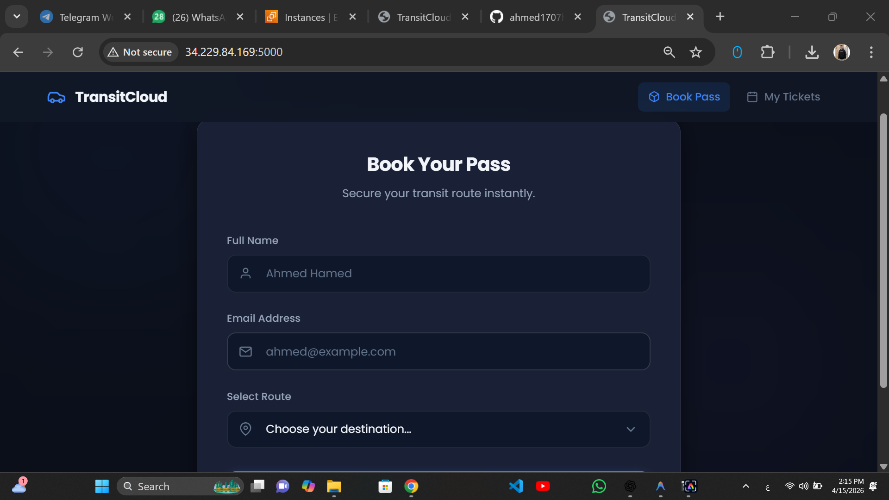
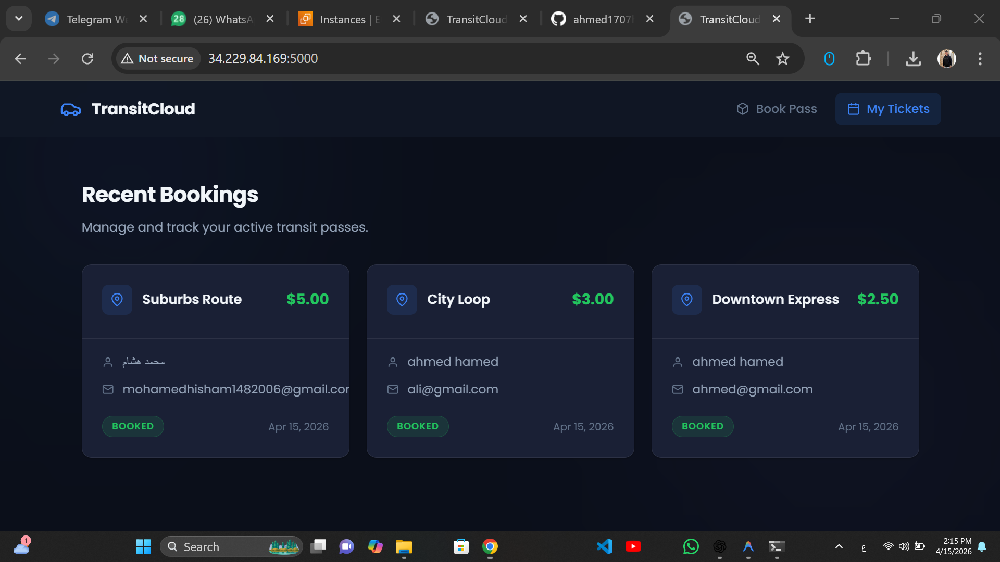
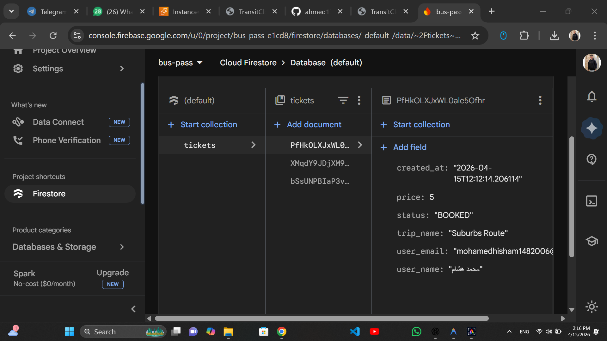
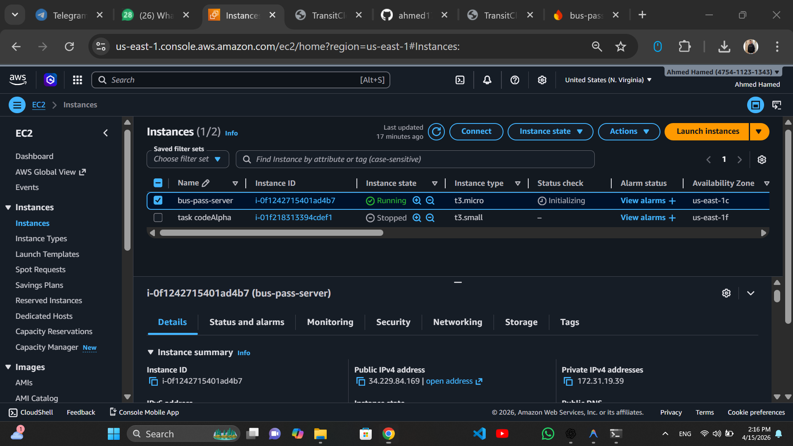

# 🚍 Cloud-Based Bus Pass System

A scalable cloud-based web application for booking and managing bus passes.
Built using **Flask**, **Firebase Firestore**, and deployed on **AWS EC2**.

---

## 🌍 Live Demo

👉 http://34.229.84.169:5000

---

## 📌 Features

* 🎫 Book bus tickets بسهولة
* 🚫 Prevent duplicate bookings
* ☁️ Cloud database باستخدام Firebase Firestore
* 📊 عرض التذاكر في شكل cards
* 🌙 Modern Dark UI
* 🚀 Deployed on AWS EC2

---

## 🛠️ Tech Stack

* **Backend:** Flask (Python)
* **Database:** Firebase Firestore
* **Frontend:** HTML, CSS, JavaScript
* **Deployment:** AWS EC2
* **Version Control:** Git & GitHub

---

## 📸 Screenshots

### 🏠 Home Page



### 🎫 Recent Bookings



### ☁️ Firebase Database



### 🌍 AWS Deployment



---

## ⚙️ Installation & Setup

### 1️⃣ Clone the repository

```bash
git clone https://github.com/ahmed1707hamed-tech/CodeAlpha-bus-pass-system.git
cd CodeAlpha-bus-pass-system
```

---

### 2️⃣ Create virtual environment

```bash
python3 -m venv venv
source venv/bin/activate
```

---

### 3️⃣ Install dependencies

```bash
pip install -r requirements.txt
```

---

### 4️⃣ Add Firebase credentials

Create a file named:

```bash
firebase.json
```

Then paste your Firebase service account credentials inside.

---

### 5️⃣ Run the application

```bash
python app.py
```

---

## 🌐 Access the App

```bash
http://localhost:5000
```

or (AWS):

```bash
http://34.229.84.169:5000
```

---

## 🔐 Security Notes

* ❌ `firebase.json` is NOT included in the repository
* ❌ `.pem` key is NOT uploaded
* ✔️ Sensitive data is protected using `.gitignore`

---

## 🚀 Future Improvements

* 🔑 User authentication (Login / Signup)
* 💳 Payment integration
* 🌍 Custom domain + HTTPS
* ⚡ Production deployment with Gunicorn & Nginx

---

## 👨‍💻 Author

**Ahmed Hamed**
🔗 GitHub: https://github.com/ahmed1707hamed-tech

---

## ⭐ If you like this project

Give it a star ⭐ on GitHub!

